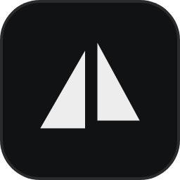

<p align="center">
  
</p>

<h1 align="center">Deltos</h1>

<p align="center">
  A fast, native database client for Windows and Linux, written in Rust with GPUI.
</p>

<p align="center">
  <a href="https://github.com/khaodius/deltos/actions/workflows/ci.yml"></a>
  <a href="LICENSE"></a>
</p>

## Features

- **Native and light**: one binary drawn on the GPU through Vulkan on Linux and DirectX on
  Windows, with no browser engine. It starts in well under a second and idles at nothing.
- **PostgreSQL, MySQL and MariaDB, SQLite and MongoDB** from one connection list. Every database
  gets the same table view, the same editor and the same shortcuts; what differs is behind one
  driver contract, and more drivers fit the same way.
- **Tables of any size**: rows are fetched as you scroll and kept in a bounded cache, never the
  whole table, so one with hundreds of millions of rows opens as fast and uses as little memory
  as one with a hundred. Sorting and filtering happen in the database, where they belong.
- **Panels you arrange**: connections, schema, tables, query and results are panels that snap
  together. Drag one to a new place, resize it, or drop it outside the window to give it a
  window of its own, and dock it back when you are done. The layout is remembered.
- **Own title bar** on Windows and Linux: slim, with the window controls, for desktops that draw
  none or when you prefer it.
- **Appearance settings**: light and dark themes, accent color, interface and code fonts, zoom
  and spacing. Every change applies immediately and is saved as plain TOML.
- **Signed updates**: Deltos checks for a new release at start, downloads it in the background
  and installs it when you ask or when you quit. An update is installed only when the release's
  manifest carries a valid signature from the project's key and the download matches the hash in
  it. The check can be turned off in Settings.

## Install

Windows, in PowerShell:

```powershell
irm https://raw.githubusercontent.com/khaodius/deltos/main/scripts/install.ps1 | iex
```

Windows, in Command Prompt:

```bat
curl -fsSL https://raw.githubusercontent.com/khaodius/deltos/main/scripts/install.cmd -o install.cmd && install.cmd && del install.cmd
```

Linux:

```sh
curl -fsSL https://raw.githubusercontent.com/khaodius/deltos/main/scripts/install.sh | bash
```

Each command downloads the latest release, checks it against the release's `SHA256SUMS.txt` and
installs it:

- **Windows**: the setup program runs silently and installs Deltos for the current user in
  `%LOCALAPPDATA%\Programs\Deltos`, with a Start menu shortcut and no admin prompt. A running
  copy is closed first, and an installed one is upgraded with its settings kept.
- **Linux**: the `.deb` through apt on Debian and Ubuntu, or the `.rpm` through dnf, zypper or
  yum on Fedora, RHEL and openSUSE, both with sudo. Any other distribution gets the binary in
  `~/.local/bin` with an applications menu entry, and `--user` picks that on any distribution,
  for your user only and without root.

A version number installs that release instead:

```sh
curl -fsSL https://raw.githubusercontent.com/khaodius/deltos/main/scripts/install.sh | bash -s -- 0.1.0
```

```powershell
& ([scriptblock]::Create((irm https://raw.githubusercontent.com/khaodius/deltos/main/scripts/install.ps1))) 0.1.0
```

```bat
curl -fsSL https://raw.githubusercontent.com/khaodius/deltos/main/scripts/install.cmd -o install.cmd && install.cmd 0.1.0 && del install.cmd
```

The scripts are in [`scripts/`](scripts) to read before running. To remove Deltos, use Installed
apps in Windows Settings, `sudo apt remove deltos` or `sudo dnf remove deltos`, or delete
`~/.local/bin/deltos` and `~/.local/share/applications/deltos.desktop`.

Or download a package from the [latest release](https://github.com/khaodius/deltos/releases/latest):

| Platform | Packages                                               |
| -------- | ------------------------------------------------------ |
| Windows  | `-setup.exe` (recommended) or portable `.zip`          |
| Linux    | `.deb`, `.rpm`, `.AppImage` or `.tar.gz`               |

The AppImage is one file that runs anywhere: make it executable and start it. Deltos updates it
in place.

Changes are listed in the [changelog](CHANGELOG.md).

### Verifying a download

Every release includes `SHA256SUMS.txt`, a signed build provenance attestation for each file,
and the signed update manifest `latest.json` with `latest.json.sig`.

```sh
# Linux, in the download folder
sha256sum --check --ignore-missing SHA256SUMS.txt

# Windows (PowerShell), compare the output with SHA256SUMS.txt
Get-FileHash <file> -Algorithm SHA256

# Provenance, with the GitHub CLI
gh attestation verify <file> --repo khaodius/deltos
```

The Windows builds are not code-signed yet, so SmartScreen may warn about an unknown publisher.

## Notes

- **Settings** are plain TOML in the Deltos configuration folder: `~/.config/deltos/` on Linux
  and `%APPDATA%\khaodius\deltos\config\` on Windows.
- **Graphics**: Linux needs a Vulkan driver (Mesa's is included with most distributions). Deltos
  runs on Wayland and X11 and picks whichever the session uses.
- **Logs** go to the terminal; `DELTOS_LOG=debug deltos` shows more. Passwords are never logged.

## Build from source

Requires [Rust](https://rustup.rs) 1.88+. On Linux, also the development packages for
xkbcommon, Wayland, X11, fontconfig and Vulkan, plus Clang for the bindings some dependencies
generate:

```sh
# Debian, Ubuntu
sudo apt install pkg-config libxkbcommon-dev libxkbcommon-x11-dev libwayland-dev libx11-xcb-dev \
  libxcb1-dev libfontconfig-dev libfreetype-dev libvulkan-dev libgbm-dev libclang-dev
# Fedora
sudo dnf install pkg-config libxkbcommon-devel libxkbcommon-x11-devel wayland-devel \
  libxcb-devel fontconfig-devel freetype-devel vulkan-loader-devel mesa-libgbm-devel clang-devel
```

```sh
git clone https://github.com/khaodius/deltos.git
cd deltos
cargo run                      # debug build
cargo build --release          # optimized build in target/release
```

## Development

CI runs these checks on Linux and Windows, plus the driver tests against live PostgreSQL,
MySQL, MariaDB and MongoDB servers:

```sh
cargo fmt --all --check
cargo clippy --workspace --all-targets -- -D warnings
cargo test --workspace
```

The workspace is split so most of Deltos is tested without a window:

| Crate                                         | Purpose                                                        |
| --------------------------------------------- | -------------------------------------------------------------- |
| [`deltos`](crates/deltos)                     | The application: windows, title bar, panels, settings screen   |
| [`deltos-data`](crates/deltos-data)           | The driver contract: connections, schemas, rows and values     |
| [`deltos-drivers`](crates/deltos-drivers)     | PostgreSQL, MySQL and MariaDB, SQLite and MongoDB behind it    |
| [`deltos-grid`](crates/deltos-grid)           | The bounded row cache and spill store behind the table view    |
| [`deltos-dock`](crates/deltos-dock)           | The panel layout: splits, tabs and floating windows            |
| [`deltos-settings`](crates/deltos-settings)   | Settings, defaults and the TOML file                           |
| [`deltos-updater`](crates/deltos-updater)     | Signed updates from GitHub releases, and the `deltos-sign` tool |

`third_party/xattr` is xattr 0.2.3 with one constant changed so it builds against current libc on
Linux; [its README](third_party/xattr/README.md) explains why.

To release, set the new version in `[workspace.package]` of `Cargo.toml`, run `cargo check` to
update `Cargo.lock`, add a section to [CHANGELOG.md](CHANGELOG.md) and merge to `main`. The
release workflow builds, signs, tags and publishes it; [docs/RELEASING.md](docs/RELEASING.md)
has the details and the signing key setup.

## License

[Apache License 2.0](LICENSE). The bundled Inter and JetBrains Mono fonts keep their own
licenses, listed in [assets/fonts](assets/fonts/README.md).
